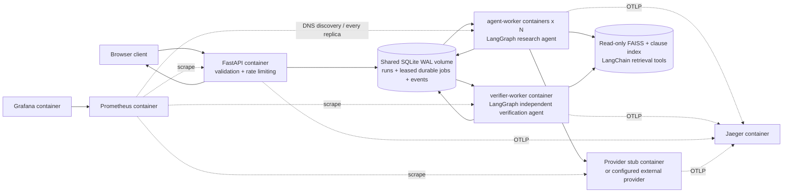

# Architecture and engineering decisions

## Domain and authority

One product category: domestic retail processed breakfast cereals (oat/rice
cereals, granola and muesli). Supplements, infant foods, imports, non-retail
containers, exemption requests and unimplemented claims escalate. A route named
`clear-for-print` is retained to match the assignment's routing enum; it means
only that the supported checks found no issue. `print_authorized` is a literal
false in the response contract. A professional makes the print decision.

## Deployment boundaries

The `init` one-shot container builds the index and initialises the schema before
workers/API start. All runtime services live in Compose. No host-side process is
needed for the demonstration. API and client are one release: the frontend is
small static HTML/CSS/JS, served on the same origin, with no build system or CDN.

Research workers scale independently because provider waiting dominates this
workload. Verification has a separate failure boundary and task queue: killing a
research process cannot publish its draft or take the verifier down. Both agents
are separate OS processes in separate containers, with different LangGraph
graphs, tool authority and durable hand-off. They are not two prompt strings.

## Durable task runner and failure semantics

SQLite is the task runner and state store, not FastAPI background tasks. Claiming
a job uses `BEGIN IMMEDIATE`; an owner and lease are assigned atomically. A
research hand-off transaction stores the evidence bundle, completes that job and
enqueues verification. Completion checks ownership and lease validity. A stale
owner cannot overwrite a new owner's result. Expired leases are reclaimed;
attempts are capped. An exhausted job is `failed`, with no confident result.

WAL supports independent readers and a short single writer on a local Docker
named volume. This is intentionally a single-host design. It trades a broker
service for a simpler clean-clone demonstration and atomic state/queue changes.
At higher concurrency, event writes and the single SQLite writer can become the
bottleneck. Do not place this volume on a network filesystem. A multi-host
deployment should replace the queue/state layer with PostgreSQL or a broker;
that migration is not claimed here.

## Research agent (LangGraph)

`plan -> execute chosen tool -> plan`, ending in a typed candidate/evidence bundle.
The planner receives the prompt version, request-derived category and claims,
observed fields, retrieved passages and their dependency links. It chooses among:

1. `request_fields(path)` - read-only allowlisted validated input lookup;
2. `corpus_search(query, family)` - LangChain FAISS retrieval;
3. `clause_lookup(clause_id)` - exact provision retrieval;
4. `finish` - hand off to verification (not a mutation tool).

The corpus-search tool has a documented metadata-filter mode: a query containing
`mandatory` in the labelling family returns the curated declaration collection.
The agent chooses that mode. It is never a mandatory pre-retrieval stage.
Subsequent calls follow links and missing provisions into the separate claims
regulation. Every selected query, passage, reason, prompt digest, timing, token
count and verification outcome is stored by run ID.

Defaults: 24 graph steps, 12 research tool calls, 5 s per local tool, 8 s per
provider attempt, 2 retries, and a 45 s submission-to-result budget. Retries use
200/400 ms exponential backoff. Three failed attempts open a per-worker provider
circuit for 20 s; the next call fails fast. Successful calls close it. Multiple
workers each have an independent breaker (no claim of a distributed breaker).

## Verification agent (LangGraph)

`independent_check -> repair_search (at most once) -> independent_check -> publish`.
Each passage is re-resolved against the pinned index, including exact content and
source hash. The verifier rebuilds the expected rule findings and arithmetic
from validated input and available provisions, checks every citation, rejects
print-authorisation language, and compares the candidate with that result.
It can repair missing evidence using a different retrieval strategy. A bad quote
or unsupported candidate is caught before publication. If support still cannot
be established, it publishes a verified escalation, never an unsupported answer.

Rule arithmetic is deliberately deterministic: the model is responsible for
planning retrieval, not manufacturing nutrient thresholds or licensing decisions.
The verifier does not call the same model to judge itself. Its faithfulness
metric is policy consistency, not a claim of independent semantic/legal truth.

## Corpus and embeddings

Official PDFs are bundled for offline clean-clone startup. Their exact URLs,
versions and SHA256 hashes are in `data/sources.json`. Clause anchors are reviewed
in `data/clause_map.json`; a changed anchor fails ingestion instead of silently
relabeling a clause. Each assessed clause is one chunk. Additional page-context
chunks use 1,500 characters with 180-character overlap to preserve source
coverage. These chunks are not automatically treated as assessed legal rules.

LangChain invokes a FAISS L2 retriever. Embeddings are local 2,048-dimensional
normalised word unigram/bigram hashing vectors. This is a lightweight lexical
embedding baseline, **not a learned semantic embedding model**. It needs no model
download, identifier, credential or paid call. Cross-regulation reliability comes
from agent-directed clause dependencies, not a claim that lexical similarity can
infer all legal relationships. Replacing the embedding adapter with a learned
local model is a future comparison, not a measured result in this submission.

Vector cache keys include the text and embedding recipe digest. Unchanged index
manifests short-circuit the pipeline. A forced rebuild reuses unchanged vectors;
changed chunks alone are embedded. Index files use FAISS binary + JSON; no pickle
or unsafe deserialisation option is used.

## Interfaces, trust and configuration

REST contracts are exported under `docs/contracts/`; `/docs` is live OpenAPI.
Input rejects are persisted with field-level errors and no run/job row. The
pipeline works from structured proposed declarations; it does not OCR artwork.
Guardrails screen every input string, including nested fields. NFKC and zero-width
normalisation precede injection detection. Tools are read-only and allowlisted.
Pattern-based injection/toxicity screening is conservative and bypassable; it is
not a comprehensive learned safety classifier. Exact output checks and the
literal-false authority field remain independent controls.

Endpoints/keys/model identifiers for an external provider are runtime settings;
there is no embedded external account or paid provider dependency. Internal
Compose service addresses are deployment wiring. `.env.example` documents every
cost/reliability setting. Test URLs in unit tests are reserved `.invalid` hosts
and intercepted by HTTPX MockTransport.

Local installation is unauthenticated and binds to localhost. Rate limits use
the direct peer IP, not an untrusted client-supplied identity header. Public
deployment requires authentication, authorisation, retention policy and TLS.

## Cache, feedback and observability

Whole-result caching covers only completed, independently verified results with
no service/evidence failure. Keys include canonical request, corpus version,
prompt version AND contents, verifier policy contents and provider configuration.
A hit creates a new run and explicit cache event, with zero new provider calls.
TTL defaults to one hour. A provider outage escalation is not cached.

Feedback is persisted and aggregated. A deterministic sample of live run IDs
(25% by default) receives automatic evidence/policy metrics and appears as a
quality history chart. This has no independent expert gold label.

W3C trace context is persisted at submission, attached by the research process,
propagated over HTTP to the stub, and handed to verification. Run ID and
correlation ID are span attributes and structured log fields. Jaeger provides
the connected trace; the run trace API provides the durable audit record.
Prometheus DNS discovery scrapes every scaled research replica. Grafana ships
16 provisioned panels. Python process CPU/memory are per-container proxies for
application services (one main process per container); optional cAdvisor is
available under the `resources` profile for a Linux host with suitable mounts.

## Alternatives rejected

- One embedding search: misses conditions in a different regulation.
- An unconstrained model's legal judgement: arithmetic and citation validity
  should be independently reproducible.
- Two prompts in one API process: fails process isolation and worker scaling.
- Host-side scripts in the demo: clean-clone runtime belongs in containers.
- A paid embedding API: no quality/cost justification for this small local corpus.
- OCR of label artwork: explicitly outside assignment scope.
- A public deployment or training a model: outside assignment scope.
